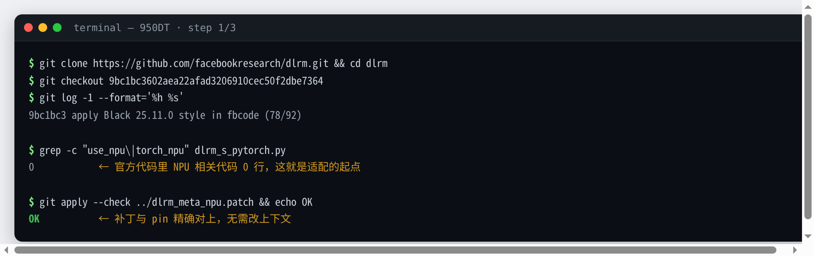
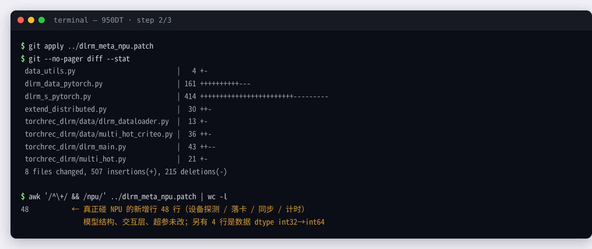
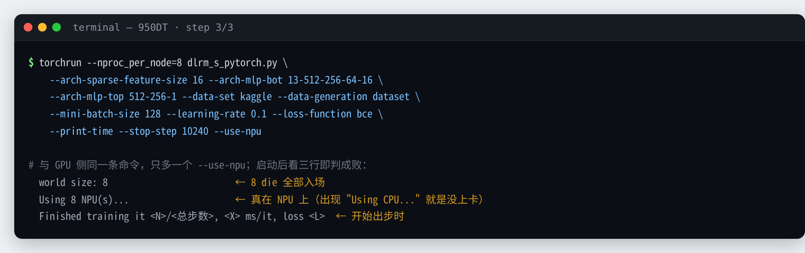

# 昇腾适配演示（极简版）：官方 DLRM 三步上卡

> 用途：向客户说明「适配量有多大」。1 张补丁 + 1 条命令。
> 版本 v1 · 2026-11-24 ｜ 第 1、2 步截图为本机真实执行回放；第 3 步为启动命令与判据，运行日志需现场采集。

**一句话**：官方代码原样取用 → 打一个补丁（**8 文件 / +507 −215，其中真正碰 NPU 的新增行 48 行**）→ 一条 `torchrun`。

---

## 第 1 步 取官方代码（0 改动）

```bash
git clone https://github.com/facebookresearch/dlrm.git && cd dlrm
git checkout 9bc1bc3602aea22afad3206910cec50f2dbe7364
grep -c "use_npu\|torch_npu" dlrm_s_pytorch.py      # 期望 0
git apply --check ../dlrm_meta_npu.patch && echo OK
```



**判据**：上游 `grep` 得 **0**（官方代码没有任何 NPU 分支，这是我们演示的起点，也是「不用重构」的证据）；`--check` 输出 `OK`（补丁与 pin 精确对齐，无需改上下文）。

---

## 第 2 步 打补丁（模型不动）

```bash
git apply ../dlrm_meta_npu.patch
git --no-pager diff --stat        # 期望 8 files changed, 507 insertions(+), 215 deletions(-)
```



**判据**：`8 files changed, 507 insertions(+), 215 deletions(-)`；其中**碰 NPU 的新增行 48 行**（设备探测 / 落卡 / 同步 / 计时），另有 **4 行**是数据 `dtype int32→int64`（Criteo 哈希是 uint32，原版 int32 装不下，约一半值会溢出）。

**边界**：补丁内容 = 设备分支 + 数据 dtype + benchmark 计量（`--stop-step` / 采样）。模型结构、交互层、超参一行未改。

---

## 第 3 步 一条命令起训练

```bash
torchrun --nproc_per_node=8 dlrm_s_pytorch.py \
  --arch-sparse-feature-size 16 --arch-mlp-bot 13-512-256-64-16 \
  --arch-mlp-top 512-256-1 --data-set kaggle --data-generation dataset \
  --mini-batch-size 128 --learning-rate 0.1 --loss-function bce \
  --print-time --stop-step 10240 --use-npu
```



**判据三条**（启动 30 秒内就能看到）：

| 日志行 | 含义 |
|---|---|
| `world size: 8` | 8 die 全部入场 |
| `Using 8 NPU(s)...` | 真在 NPU 上。**出现 `Using CPU...` 就是没上卡**（原版 `--use-gpu` 在昇腾上恒降级 CPU，必须打补丁） |
| `Finished training it … ms/it` | 已出步时，进入稳态 |

与 GPU 侧同一条命令，只多一个 `--use-npu`。

---

## 演示时不要说的三句话

1. **不说「零改动」** —— 上游 0 处 NPU 代码，NPU 支持来自我方补丁；正确说法是「官方代码不用重构，补丁集中在设备层」。
2. **不说「精度已验证」** —— 这条链路证明的是「官方代码在昇腾上跑得起来、步时正常」；精度要 Criteo 全量 + AUC 口径单独出。
3. **不拿它和 A100 四档数字相除** —— 数据量（45.8 M vs 4.19 B）、稀疏维度（16 vs 128）、稠密结构全不同，只能并列不能算达成率。

---

## 附：环境自检（30 秒，演示开场用）

```bash
npu-smi info | head -4                                     # SOC / die 数 / HBM
python3 -c "import torch,torch_npu;print(torch.__version__,torch_npu.__version__,torch_npu.npu.device_count())"
```

**判据**：SOC 为 `Ascend950DT` ∧ `die 数 8` ∧ `torch_npu 2.7.1.post4` ∧ `device_count = 8`。
同机完整自检输出（含驱动/CANN/`fbgemm_ascend` 算子目录 A5）：`results/check_env_950.txt`，末行 `[VERDICT] 环境就绪`。
